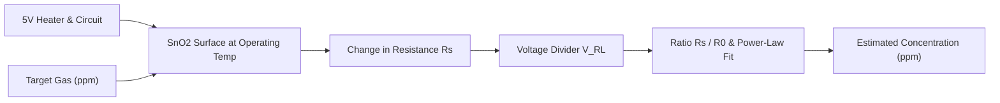
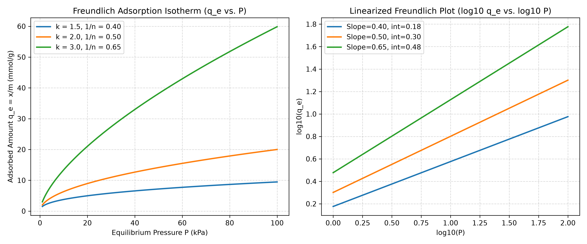
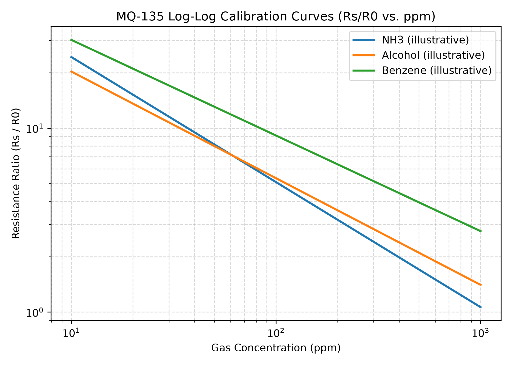

# Technical Report: MQ-135 Gas Sensor, Multi-Gas Calibration, and Freundlich Adsorption Isotherm

## 1. Overview and Operating Principle

The **MQ-135** is a metal-oxide semiconductor (MOS) gas sensor used for air quality monitoring and detecting hazardous gases or volatile organic compounds (VOCs). Its sensing core consists of an aluminum oxide ($\text{Al}_2\text{O}_3$) ceramic tube coated with a **tin dioxide ($\text{SnO}_2$)** sensitive layer, an internal nickel-chromium heater coil, and gold/platinum electrodes housed beneath a stainless-steel mesh cap.

### Sensing Mechanism
1. **Clean Air Baseline:** Powered at a nominal $5.0\text{ V}$ heater voltage, atmospheric oxygen adsorbs onto the heated $\text{SnO}_2$ surface and captures free electrons to form negatively charged oxygen ions ($\text{O}_2^-$, $\text{O}^-$, $\text{O}^{2-}$). This creates an electron-depletion layer with a relatively high sensor resistance ($R_s$).
2. **Gas Exposure:** When reducing gases or vapors (such as ammonia, ethanol, benzene, or smoke) contact the $\text{SnO}_2$ surface, they react with adsorbed oxygen species and release trapped electrons back into the conduction band. As gas concentration rises, $R_s$ decreases.

### Voltage-Divider Resistance Formula
With supply voltage $V_c$, load resistor $R_L$, and output voltage $V_{RL}$ measured across $R_L$:

$$R_s = \left( \frac{V_c}{V_{RL}} - 1 \right) R_L$$

### Key Specifications
* **Heater / Supply Voltage ($V_H, V_c$):** $5.0\text{ V} \pm 0.1\text{ V}$
* **Load Resistance ($R_L$):** Adjustable; typically $20\text{ k}\Omega$ (commonly $10\text{ k}\Omega\text{–}47\text{ k}\Omega$)
* **Target Gases:** Ammonia ($\text{NH}_3$), nitrogen oxides ($\text{NO}_x$), alcohol (ethanol), benzene, smoke, carbon dioxide ($\text{CO}_2$), and VOCs
* **Typical Concentration Range:** $10\text{–}300\text{ ppm}$ ($\text{NH}_3$, alcohol) and $10\text{–}1000\text{ ppm}$ (benzene and general air contaminants)
* **Burn-in / Preheat Time:** Up to $24\text{ hours}$ for initial stabilization before calibration

---

## 2. Calibration Methodology and Calibration for Different Gases

Because MQ-135 sensors respond to multiple gases and drift with temperature and humidity, raw voltage must be converted into a resistance ratio $\frac{R_s}{R_0}$ and mapped against known gas concentrations.

### Calibration Procedure
1. **Burn-in and Warm-up:** Energize the sensor for up to $24\text{ hours}$ initially (and allow a warm-up period before logging) so surface oxygen kinetics stabilize.
2. **Establish Baseline $R_0$:** Record $R_s$ under known clean/reference air conditions (and controlled temperature/humidity) to determine $R_0$.
3. **Collect Multi-Point Data:** Expose the sensor to known $\text{ppm}$ concentrations of the target gas and compute $R_s$ at each steady-state reading.
4. **Fit Power-Law / Log-Log Model:** Over the linear region on a log-log scale, $\frac{R_s}{R_0}$ follows:

$$\frac{R_s}{R_0} = A \cdot C^b$$

Taking base-10 logarithms yields a linear equation:

$$\log_{10}\left(\frac{R_s}{R_0}\right) = \log_{10}(A) + b \log_{10}(C)$$

where $C$ is gas concentration in $\text{ppm}$, $A$ is the scaling constant, and $b$ is the log-log slope (negative for reducing gases).

### Calibration Profiles Across Target Gases

| Gas / Vapor | Response Characteristics | Typical $R_s/R_0$ Behavior (Illustrative) | Calibration & Deployment Notes |
| :--- | :--- | :--- | :--- |
| **Ammonia ($\text{NH}_3$)** | Strong reducing response; commonly used as a standard reference curve | Drops from $\sim 3.6$ ($50\text{ ppm}$) to $\sim 2.2$ ($100\text{ ppm}$) and $\sim 0.6$ ($500\text{ ppm}$) | Calibrate directly with $\text{NH}_3$ standards when ammonia is the primary gas |
| **Alcohol (Ethanol)** | High sensitivity and fast response; strong cross-sensitivity | Steep decrease across $10\text{–}300\text{ ppm}$ | Calibrate with ethanol vapor; cleaning alcohol or sanitizers cause false spikes |
| **Benzene & VOCs** | Moderate-to-high response across $10\text{–}1000\text{ ppm}$ | Decreases across range (e.g., $\sim 5.0$ at $50\text{ ppm}$, $\sim 3.0$ at $100\text{ ppm}$, $\sim 1.0$ at $500\text{ ppm}$) | Suitable for indoor VOC/air-quality screening rather than strict trace compliance |
| **Carbon Dioxide ($\text{CO}_2$)** | Weaker resistance shift than strong reducing gases/VOCs | Shallower decline across elevated $\text{ppm}$ (e.g., $\sim 4.0$ at $50\text{ ppm}$, $\sim 2.5$ at $100\text{ ppm}$, $\sim 0.7$ at $500\text{ ppm}$) | Poor standalone selectivity for $\text{CO}_2$; use NDIR sensors for true $\text{CO}_2$ measurement |
| **Smoke & $\text{NO}_x$** | Combined response to combustion aerosols and reactive gases | Sharp drop during smoke/combustion exposure | Best used for event/threshold detection or relative air-quality indexing |

### Environmental & Cross-Sensitivity Notes
* **Temperature and Humidity:** Ambient temperature and relative humidity shift surface oxygen/hydroxyl coverage on $\text{SnO}_2$; log both variables alongside $R_s/R_0$ for field compensation.
* **Sensor Poisoning:** Keep away from silicone vapors, corrosive gases, halogens, high-salt aerosols, and liquid condensation, which can permanently degrade sensitivity.

---

## 3. Freundlich Adsorption Isotherm and Graph Code

The **Freundlich adsorption isotherm** models gas-solid or solute-surface adsorption at constant temperature ($T$) on **heterogeneous surfaces** with non-uniform adsorption site energies:

$$\frac{x}{m} = q_e = k \, P^{1/n}$$

where:
* $\frac{x}{m}$ (or $q_e$) is the amount of adsorbate uptake per unit mass of adsorbent.
* $P$ (or equilibrium concentration $C_e$) is the equilibrium partial pressure or concentration.
* $k$ is the Freundlich capacity constant at constant temperature.
* $\frac{1}{n}$ is the surface heterogeneity / adsorption intensity factor (typically $0 < \frac{1}{n} < 1$, or $n > 1$, for favorable adsorption).

### Linearized Form
Taking $\log_{10}$ on both sides gives:

$$\log_{10}\left(\frac{x}{m}\right) = \log_{10}(k) + \frac{1}{n} \log_{10}(P)$$

A plot of $\log_{10}(q_e)$ versus $\log_{10}(P)$ forms a straight line with **slope $= \frac{1}{n}$** and **y-intercept $= \log_{10}(k)$**.

